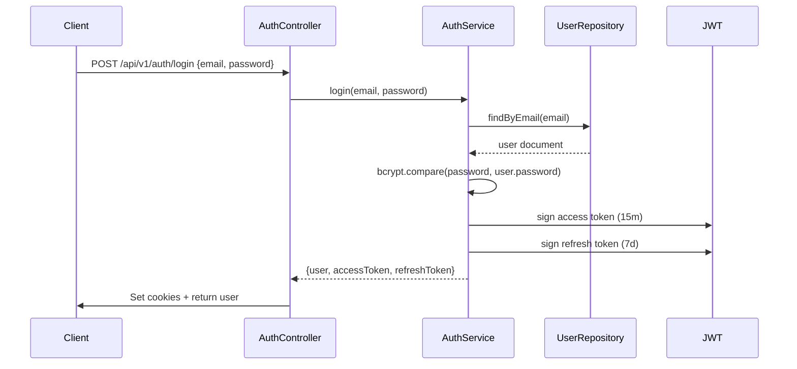
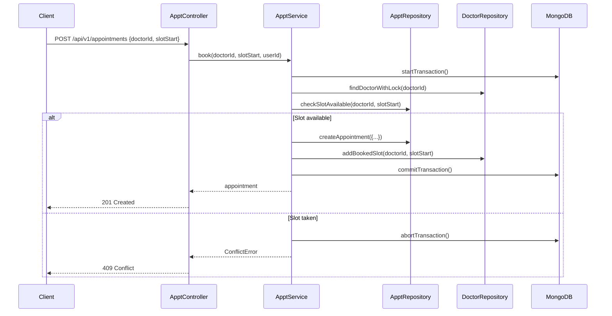

# System Architecture

**Project:** MediConnect: Smart Healthcare Appointment & Clinic Management Platform  
**Version:** 1.0  
**Date:** 2026-11-06  
**Status:** Draft (from Phase 1 audit of existing codebase + Phase 2 planned changes)

---

## 1. System Overview

### Current State (Pre-Phase 2)
A simple Express.js REST API with MongoDB/Mongoose, organized as:
```
routes/ → controllers/ → models/ → MongoDB
```

### Target State (Post-Phase 2)
Layered architecture with clear separation of concerns:
```
routes/ → controllers/ → services/ → repositories/ → models/ → MongoDB
                     ↓
            centralized error handling
                     ↓
            standard API response format
```

### Architecture Style
- **Pattern:** Layered (n-tier) architecture
- **Communication:** RESTful HTTP/JSON
- **Database:** MongoDB (document-based) with Mongoose ODM
- **Authentication:** JWT (access + refresh tokens) in HttpOnly cookies
- **Validation:** Zod schemas on every endpoint
- **API Versioning:** `/api/v1/...` prefix

---

## 2. Technology Stack (Confirmed)

| Layer | Technology | Version | Notes |
|-------|------------|---------|-------|
| Runtime | Node.js | 18+ | ES Modules (`"type": "module"`) |
| Framework | Express | 5.2.1 | |
| Language | TypeScript | 5.x | Incremental migration (`allowJs: true`) |
| Database | MongoDB | 7.x | Atlas (prod), replica set (local) |
| ODM | Mongoose | 9.9.4 | |
| Validation | Zod | 3.x | TypeScript-first, infers types |
| Auth | jsonwebtoken | 9.0.3 | bcrypt for hashing |
| Logging | pino | 9.x | Structured JSON logging |
| Config | dotenv | 17.x | `.env.example` committed |
| Dev Tools | tsx, ESLint, Prettier | latest | |
| Testing | Vitest | 2.x | Unit + integration |
| Containerization | Docker + docker-compose | | MongoDB as single-node replica set |

---

## 3. Current Architecture (Pre-Phase 2) — From Audit

### Request Flow
```
Client Request
    │
    ▼
Express App (server.js)
    │
    ├── cors(), express.json(), cookieParser()
    │
    ├── /api/admin/*  ──► adminRouter ──► adminController ──► Models
    ├── /api/doctor/* ──► doctorRouter ─► doctorController ─► Models
    └── /api/user/*   ──► userRouter ───► userController ───► Models
    │
    ▼
MongoDB (via Mongoose)
```

### Current Module Structure
```
Backend/
├── config/
│   ├── mongodb.js          # Mongoose connection
│   └── cloudinary.js       # Cloudinary config
├── controller/
│   ├── adminController.js  # Add doctor, admin login, list doctors
│   ├── doctorController.js # List doctors, toggle availability
│   └── userController.js   # Auth, profile, appointments, payments
├── middlewares/
│   ├── authUser.js         # Patient JWT verification
│   ├── authadmin.js        # Admin JWT verification
│   └── multer.js           # File upload config
├── models/
│   ├── user.model.js       # Patient schema
│   ├── doctor.model.js     # Doctor schema
│   └── appointment.model.js # Appointment schema
├── routes/
│   ├── admin.route.js
│   ├── doctor.route.js
│   └── user.route.js
├── server.js               # Express entry point
└── package.json
```

### Current Data Models (from Audit)

```mermaid
erDiagram
    USER ||--o{ APPOINTMENT : "books"
    DOCTOR ||--o{ APPOINTMENT : "receives"
    USER {
        string _id PK
        string name
        string email UK
        string password
        string image
        object address
        string gender
        string dob
        string phone
    }
    DOCTOR {
        string _id PK
        string name
        string email UK
        string password
        string image
        string speciality
        string degree
        string experience
        string about
        boolean available
        number fees
        object address
        date createdAt
        object slots_booked  // Denormalized: { "2024-01-15": ["10:00", "10:30"] }
    }
    APPOINTMENT {
        string _id PK
        string userId FK
        string docId FK
        string slotDate
        string slotTime
        object userData  // Denormalized snapshot
        object docData   // Denormalized snapshot
        number amount
        number date      // Timestamp
        boolean cancelled
        boolean payment
        boolean isCompleted
    }
```

---

## 4. Target Architecture (Post-Phase 2)

### Layered Structure

```
src/
├── config/
│   ├── index.ts              # Centralized config (env validation)
│   ├── database.ts           # Mongoose connection + replica set init
│   └── cloudinary.ts         # Cloudinary config
├── modules/
│   ├── auth/
│   │   ├── routes.ts
│   │   ├── controller.ts
│   │   ├── service.ts
│   │   ├── repository.ts
│   │   ├── schemas.ts        # Zod schemas
│   │   └── types.ts
│   ├── users/
│   │   ├── routes.ts
│   │   ├── controller.ts
│   │   ├── service.ts
│   │   ├── repository.ts
│   │   ├── schemas.ts
│   │   └── types.ts
│   ├── doctors/
│   │   ├── routes.ts
│   │   ├── controller.ts
│   │   ├── service.ts
│   │   ├── repository.ts
│   │   ├── schemas.ts
│   │   └── types.ts
│   ├── appointments/
│   │   ├── routes.ts
│   │   ├── controller.ts
│   │   ├── service.ts
│   │   ├── repository.ts
│   │   ├── schemas.ts
│   │   └── types.ts
│   └── admin/
│       ├── routes.ts
│       ├── controller.ts
│       ├── service.ts
│       ├── repository.ts
│       ├── schemas.ts
│       └── types.ts
├── shared/
│   ├── middleware/
│   │   ├── errorHandler.ts      # Centralized error handling
│   │   ├── validate.ts          # Zod validation middleware
│   │   ├── auth.ts              # JWT verification (access/refresh)
│   │   ├── rbac.ts              # Role-based access control
│   │   └── rateLimiter.ts       # Rate limiting
│   ├── utils/
│   │   ├── apiResponse.ts       # Standard API response format
│   │   ├── logger.ts            # Pino logger
│   │   ├── jwt.ts               # Token utilities
│   │   ├── password.ts          # Bcrypt utilities
│   │   └── errors.ts            # Custom error classes
│   ├── types/
│   │   ├── express.d.ts         # Extended Express types
│   │   └── common.ts            # Shared types
│   └── constants/
│       ├── roles.ts             # Role enums
│       ├── statusCodes.ts       # HTTP status codes
│       └── messages.ts          # Error/success messages
├── app.ts                       # Express app setup
└── server.ts                    # Entry point
```

### Request Flow (Target)

```
Client Request
    │
    ▼
Express App (app.ts)
    │
    ├── helmet(), cors(configured), express.json(), cookieParser()
    ├── pino HTTP logger
    │
    ├── /api/v1/auth/*     ──► authRouter ──► authController ──► authService ──► authRepository
    ├── /api/v1/users/*    ──► usersRouter ──► usersController ──► usersService ──► usersRepository
    ├── /api/v1/doctors/*  ──► doctorsRouter ─► doctorsController ─► doctorsService ─► doctorsRepository
    ├── /api/v1/appointments* ──► apptsRouter ──► apptsController ──► apptsService ──► apptsRepository
    └── /api/v1/admin/*    ──► adminRouter ──► adminController ──► adminService ──► adminRepository
    │
    ▼
Centralized Error Handler → Standard API Response
    │
    ▼
MongoDB (via Mongoose + Repositories)
```

---

## 5. Component Relationships & Data Flows

### Key Design Principles

1. **Controller** — Thin, only handles HTTP concerns (request parsing, response formatting)
2. **Service** — Business logic, orchestrates repositories, transactions, validation
3. **Repository** — Data access only, no business logic, testable with mocks
4. **Middleware** — Cross-cutting concerns (auth, validation, errors, rate limiting)
5. **Schemas (Zod)** — Single source of truth for validation + TypeScript types

### Authentication Flow



### Appointment Booking Flow (with Concurrency Control)



---

## 6. Database Architecture

### MongoDB Collections (Post-Phase 2)

| Collection | Key Indexes | Notes |
|------------|-------------|-------|
| `users` | `email` (unique), `createdAt` | Patient accounts |
| `doctors` | `email` (unique), `speciality`, `available`, `fees`, `createdAt` | Doctor profiles |
| `appointments` | `userId`, `doctorId`, `slotStart`, **`doctorId + slotStart` (unique, partial: cancelled=false)**, `status`, `createdAt` | Booking records |
| `doctor_availability` | `doctorId`, `dayOfWeek` | Weekly schedule |
| `doctor_leave` | `doctorId`, `date` | Leave days |
| `notifications` | `userId`, `read`, `createdAt` | In-app notifications |
| `audit_logs` | `userId`, `action`, `resource`, `createdAt` | Security audit trail |

### Transaction Strategy
- MongoDB transactions require replica set
- Local: single-node replica set via docker-compose
- Production: MongoDB Atlas (managed replica set)
- Used for: booking (check slot + create appointment + update doctor slots atomically)

---

## 7. API Architecture

### Versioning
- All endpoints under `/api/v1/`
- Future versions: `/api/v2/`

### Standard Response Format

```typescript
// Success
{
  "success": true,
  "data": T,
  "meta": { "page": 1, "limit": 20, "total": 100 }  // for paginated responses
}

// Error
{
  "success": false,
  "error": {
    "code": "VALIDATION_ERROR",
    "message": "Invalid input",
    "details": [{ "field": "email", "message": "Invalid email format" }]
  }
}
```

### HTTP Status Codes
| Code | Usage |
|------|-------|
| 200 | Success (GET, PUT, PATCH) |
| 201 | Created (POST) |
| 204 | No Content (DELETE) |
| 400 | Validation Error |
| 401 | Unauthenticated |
| 403 | Forbidden (RBAC) |
| 404 | Not Found |
| 409 | Conflict (double-booking, duplicate) |
| 422 | Unprocessable Entity (business rule violation) |
| 429 | Too Many Requests (rate limit) |
| 500 | Internal Server Error |

### Pagination, Filtering, Sorting
- **Pagination:** `page`, `limit` query params (default: page=1, limit=20, max=100)
- **Filtering:** Field-specific query params (e.g., `speciality=cardiology`, `available=true`)
- **Sorting:** `sortBy=field:direction` (e.g., `sortBy=createdAt:desc`)

---

## 8. Security Architecture

### Authentication
- **Access Token:** JWT, 15 min expiry, in HttpOnly cookie + Authorization header
- **Refresh Token:** JWT, 7 days expiry, in HttpOnly cookie, rotated on use
- **Password Hashing:** bcrypt, 12 rounds
- **Token Storage:** HttpOnly, Secure, SameSite=Lax cookies

### Authorization (RBAC)
| Role | Permissions |
|------|-------------|
| `PATIENT` | Own profile, own appointments, book/cancel, search doctors |
| `DOCTOR` | Own profile, own schedule, own appointments, patient details (assigned), consultation notes |
| `ADMIN` | All doctors, all patients, all appointments, analytics, doctor verification |

### Protection Layers
1. **Network:** CORS restricted to known origins
2. **Transport:** HTTPS only (production), Helmet headers
3. **Application:** Rate limiting (auth: 10/min, API: 100/min)
4. **Data:** Input validation (Zod), output sanitization
5. **Secrets:** `.env` only, never committed, rotated regularly

---

## 9. Infrastructure & Deployment

### Local Development (docker-compose)
```yaml
services:
  mongodb:
    image: mongo:7
    command: ["--replSet", "rs0", "--bind_ip_all"]
    ports: ["27017:27017"]
    volumes: ["mongodb_data:/data/db"]
    healthcheck: test: ["CMD", "mongosh", "--eval", "db.adminCommand('ping')"]
  
  api:
    build: ./Backend
    ports: ["4000:4000"]
    environment: 
      - MONGODB_URI=mongodb://mongodb:27017/medi_connect?replicaSet=rs0
      - NODE_ENV=development
    depends_on:
      mongodb:
        condition: service_healthy
    command: ["tsx", "watch", "src/server.ts"]
```

### Production
- **Frontend:** Vercel (Next.js/React + Vite)
- **Backend:** Render / Railway / Fly.io
- **Database:** MongoDB Atlas (managed replica set)
- **Redis:** Upstash / Redis Cloud (for caching + BullMQ)
- **File Storage:** Cloudinary (images)
- **Payments:** Razorpay/Stripe test mode

---

## 10. Scalability & Reliability

### Horizontal Scaling
- Stateless API servers (session in JWT, not memory)
- MongoDB read replicas for queries
- Redis for caching + session store
- BullMQ workers for background jobs

### Reliability Patterns
- **Circuit Breaker:** For external services (Cloudinary, Razorpay)
- **Retry with Backoff:** For transient failures
- **Health Checks:** `/api/v1/health` (liveness + readiness)
- **Graceful Shutdown:** SIGTERM handling, drain connections

---

## 11. Observability

### Logging (Pino)
- Structured JSON logs
- Levels: error, warn, info, debug
- Request ID correlation
- Log sampling for high-volume endpoints

### Metrics (Future)
- Prometheus endpoint
- Key metrics: request latency, error rate, booking success rate, queue depth

### Tracing (Future)
- OpenTelemetry for distributed tracing

---

## 12. Architecture Decision Records (Summary)

| Decision | Recorded In |
|----------|-------------|
| TypeScript incremental migration | `docs/decision.md` #1 |
| Zod for validation | `docs/decision.md` #2 |
| MongoDB + Mongoose (replica set) | `docs/decision.md` #3 |
| Layered architecture (routes→controllers→services→repositories) | This document |
| JWT access + refresh tokens | Phase 3 scope |
| Repository pattern for data access | This document |
| Standard API response format | This document |

---

*This architecture document is based on the Phase 1 audit of the actual Backend codebase and the Phase 2 planned implementation. It will be updated as code changes are made.*
